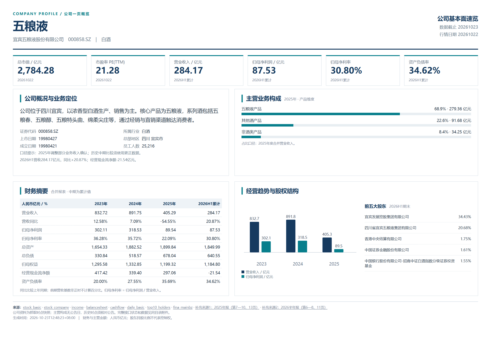

# Company Profile · 上市公司一页概览

输入 **股票全称、简称或代码**，生成一页中文公司介绍：主营业务、营收结构、三年财务摘要、估值、趋势与股东。适合 pitch book、买方介绍和公司研究速览。

**Tushare 有 Token 就用；没有 Token 用 AKShare。** 当前采集范围为沪深京 A 股，数据与来源可检查，HTML可离线打开。



[查看示例HTML源码](examples/wuliangye/company-profile.html) · [示例数据](examples/wuliangye/profile.json)

示例是2026年10月23日采集的历史快照，财务最新期为2026年半年报、行情日期为2026年10月22日，不会自动更新。营收结构已对照年报核实。案例用于展示排版与数据口径。

## 安装为 Skill

```bash
npx skills add amberbrook0104/company-profile --skill company-profile
```

也可克隆本仓库到你的技能目录 `~/.codex/skills/company-profile`，或将仓库作为项目内Skill安装；`SKILL.md`位于仓库根目录。不要把Token写进该目录。

在支持Skill的Agent中说：

```text
使用 $company-profile 给五粮液做一页公司概览
使用 $company-profile 分析宜宾五粮液股份有限公司的公司基本面
使用 $company-profile 生成 000858 的一页介绍
```

## 直接运行

需要Python 3.10+。无Token路径安装AKShare：

```bash
python -m pip install -r requirements.txt
python scripts/run_profile.py "五粮液" --out output/wuliangye
```

以下输入均可识别同一证券：

```bash
python scripts/run_profile.py "宜宾五粮液股份有限公司" --out output/wuliangye
python scripts/run_profile.py 000858 --out output/wuliangye
python scripts/run_profile.py 000858.SZ --out output/wuliangye
python scripts/run_profile.py sz000858 --out output/wuliangye
```

简称与名称基于在线证券目录识别。存在多个候选时，程序返回候选名称和代码，不会擅自猜测；网络、退市、名称变更或供应商字段变化可能需要重新核对。

仅识别股票、不取财报：

```bash
python scripts/fetch_profile.py "五粮液" --resolve-only
```

### 有 Tushare Token

在本机终端隐藏输入，避免Token进入命令历史：

```bash
python scripts/run_profile.py "五粮液" --prompt-token --out output/wuliangye
```

也支持已配置的 `TUSHARE_TOKEN`、SDK默认凭证文件和 `--token-file` 引用。交互输入留空时自动走AKShare。不要把密钥发到Issue、聊天、仓库或示例文件。

强制指定来源：

```bash
python scripts/run_profile.py "五粮液" --source akshare --out output/wuliangye
python scripts/run_profile.py "五粮液" --source tushare --out output/wuliangye
```

自动模式不会在Token认证失败后悄悄改用另一来源；可修正Token或明确选择AKShare。

## 输出与图片

默认生成 `company-profile.html`、`profile.json`、`raw.json`、`sources.csv`。网页自包含，无需部署网站。可核对公告后补充 `editorial.json`，重新渲染：

```bash
python scripts/render_profile.py --input output/wuliangye/profile.json --out output/wuliangye/company-profile.html --editorial examples/wuliangye/editorial.json
```

上述editorial仅适用于五粮液历史案例，其他公司应重新撰写并核实来源。

PNG导出需要Node.js、Playwright和本机Chrome/Edge：

```bash
npm install --ignore-scripts
node scripts/export_profile.cjs --html output/wuliangye/company-profile.html --png output/wuliangye/company-profile.png
```

浏览器不在标准位置时附 `--browser /absolute/path/to/browser`。不提供或自动下载浏览器。`--pdf output/wuliangye/company-profile.pdf` 可同时导出PDF。

## 数据口径

- Tushare：公司信息、合并报表、日度估值、主营构成及股东；权限依账号实际状态。
- AKShare：公开证券目录、合并财务报表、主营业务及公开估值/股东接口；无Token，无付费权限升级。
- 金额统一为人民币亿元；日期、PE口径、合并与归母口径明确区分。中期数据为累计值。
- 不把未获得的数据填成0。必要财务接口全部失败时停止生成空白概览，其余缺失留痕。
- AKShare中的供应商更新日期不能当作原公告日；其路径只支持当前快照。历史时点研究需Tushare与原公告复核。
- 业务构成初始为待核验，确认分类互斥后才展示占比。没有Logo或图像授权时使用文本版式。

数据网站有时会限流或调整结构，因此不能保证所有接口在所有网络环境始终可用。详见[数据来源与字段](references/data-sources.md)。本工具输出公司事实概览，不生成买卖建议。

## 验证

```bash
python -m unittest discover -s tests -v
```

测试覆盖名称/简称/代码识别、歧义、交易所后缀、两种来源选择、财务字段及单位映射、缺失值与页面信息。真实在线验证结果见[验证说明](docs/validation.md)。

软件采用MIT许可。金融数据、公司商标等仍受各自来源条款约束。
